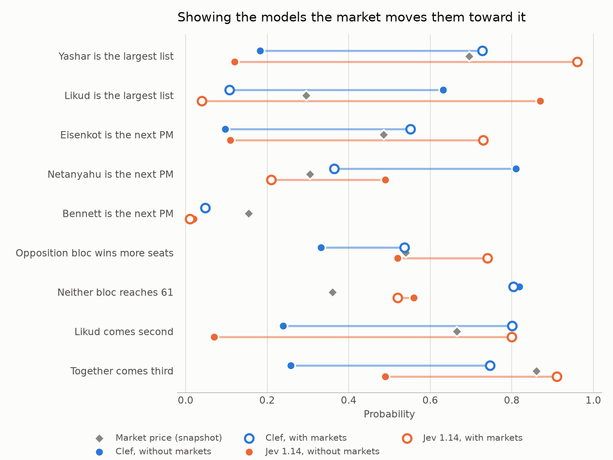
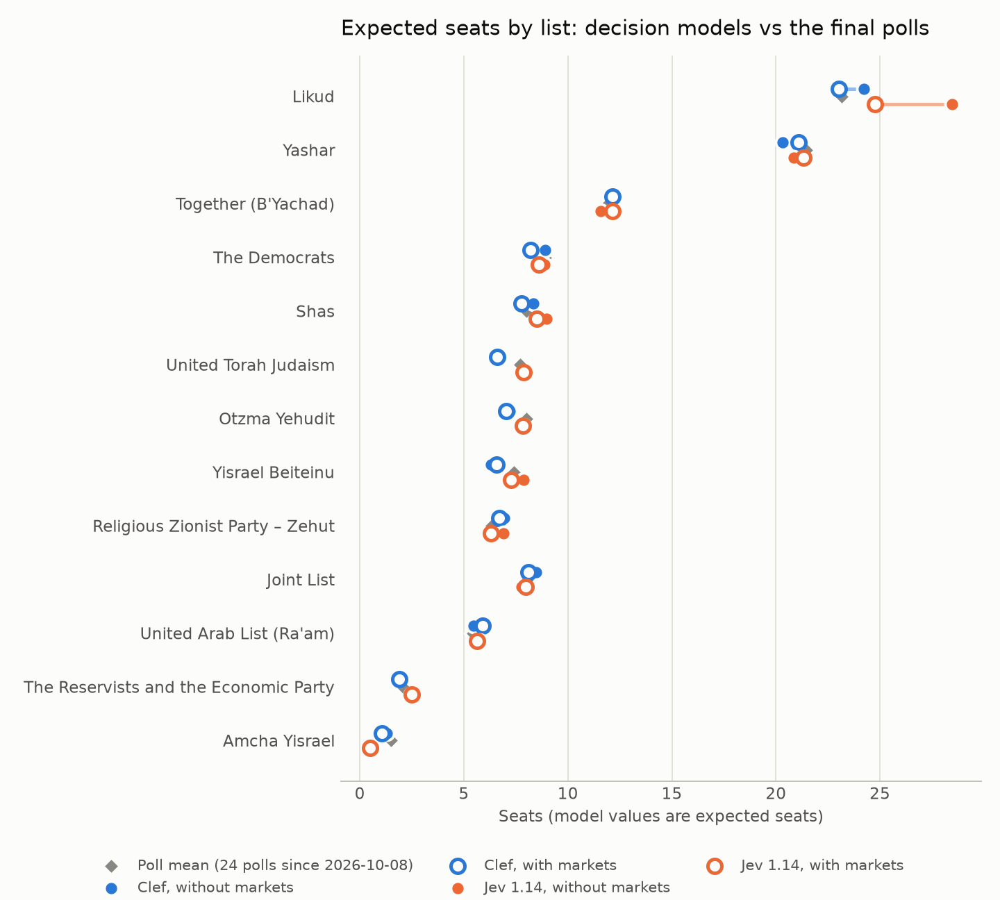
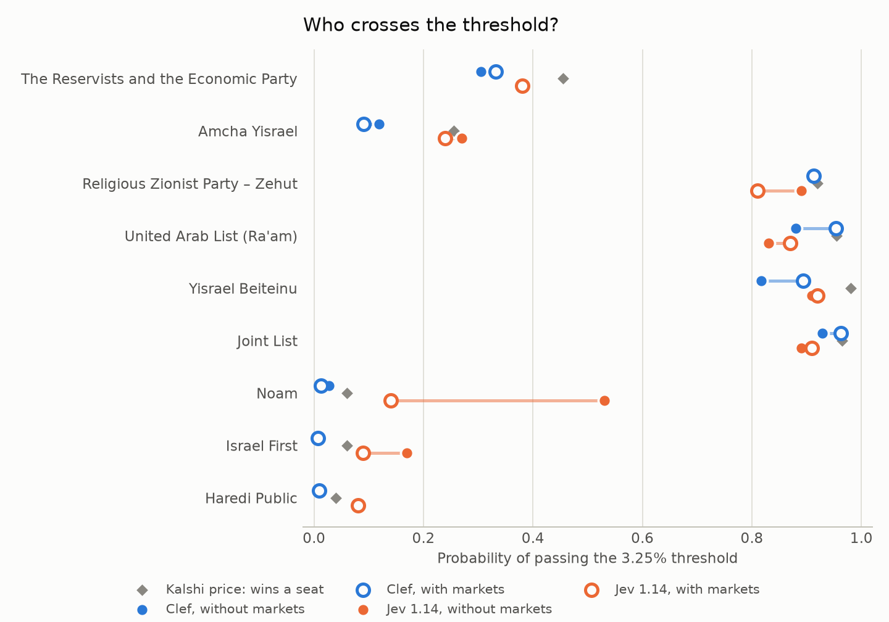
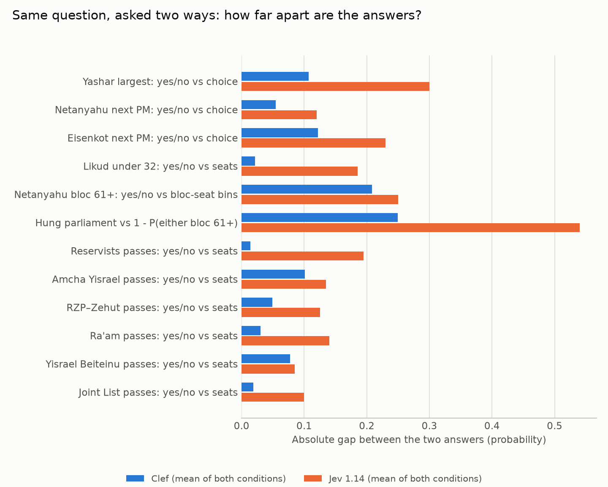

# Forecasting the 2026 Knesset election with decision models

**Run:** `2026-10-22T1942Z`. The forecast was frozen on 22 October 2026, five days before polling day on 27 October. 
**Panel:** `cloudflare/clef` (Clef) and `typesafe/jev-1.14` (Jev 1.14), called through OpenRouter's System One endpoint. No LLMs and no judge. 
**Cost of the run:** $0.0159 for 4 requests and 39 questions each, 156 answers in all. 
**Repo:** <https://github.com/danielrosehill/Israeli-Elections-2026>

## What was asked

Decision models don't write text. They take a block of evidence (the *state*) and a set of typed questions, and return probabilities:

- yes/no questions (`noul`);
- one-of-N questions (`choice`);
- ordered bins (`score`).

The panel answered **39 election-only questions** in six groups:

- headline result (5 questions);
- blocs (5);
- seats per list (13);
- the 3.25% threshold (11);
- turnout (2);
- prime minister (3).

Several questions ask for the same quantity in two different ways, so each model's internal consistency can be measured.

Both models received the same frozen evidence pack, about 25–29k tokens, under two conditions:

- **without markets:**
    - the election rules;
    - the outgoing Knesset;
    - the top of every candidate list;
    - all 75 standard polls since 1 September, with monthly and per-pollster means;
    - a 3,000-word factual news digest up to 22 October.
- **with markets:** the same pack, plus a section of Kalshi and Polymarket prices snapshotted at 19:41 UTC on 22 October.

The resolution rule for every question is written down in `questions.json` and was fixed before the run. When the CEC certifies the result, every answer will get a Brier score, and so will the market prices.

## Headline: the market section decides who "wins"

Without the market prices, both models favour Likud as the largest list and Netanyahu as the next prime minister:

| | Clef | Jev 1.14 |
|---|---|---|
| Likud largest list | 0.63 | 0.87 |
| Netanyahu next PM | 0.81 | 0.49 |

Add the market section and both models flip:

| | Clef | Jev 1.14 | Market |
|---|---|---|---|
| Yashar largest list | 0.73 | 0.96 | 0.69 |
| Eisenkot next PM | 0.55 | 0.73 | 0.49 |

The market moved both models past the market's own price, not just towards it. This is the clearest finding of the run: **for the headline questions, these models are mostly reading the market back.** The polls are the same in both conditions. Their mean has Likud at 23.2 seats and Yashar at 21.5, and neither model's seat estimates change much between conditions (next chart).

Jev's flip goes furthest. At 0.96 for Yashar it is more confident than any market or poll average supports.

## Seats: stable, and close to the polls

Expected seats, from each model's full seat distribution, against the mean of the 24 polls published since 8 October:

| List | Poll mean | Clef (no mkt / mkt) | Jev (no mkt / mkt) |
|---|---|---|---|
| Likud | 23.2 | 24.2 / 23.0 | 28.5 / 24.8 |
| Yashar | 21.5 | 20.3 / 21.1 | 20.9 / 21.3 |
| Together | 12.0 | 12.2 / 12.1 | 11.6 / 12.2 |
| The Democrats | 8.9 | 8.9 / 8.2 | 8.9 / 8.6 |
| Shas | 8.0 | 8.4 / 7.8 | 9.0 / 8.5 |
| Joint List | 8.0 | 8.5 / 8.1 | 7.8 / 8.0 |
| Otzma Yehudit | 8.0 | 7.2 / 7.0 | 7.9 / 7.8 |
| UTJ | 7.7 | 6.5 / 6.6 | 7.9 / 7.9 |
| Yisrael Beiteinu | 7.4 | 6.3 / 6.6 | 7.9 / 7.3 |
| RZP–Zehut | 6.3 | 6.9 / 6.7 | 6.9 / 6.3 |
| Ra'am | 5.4 | 5.5 / 5.9 | 5.8 / 5.6 |
| Reservists + Economic | 2.1 | 1.8 / 1.9 | 2.5 / 2.5 |
| Amcha Yisrael | 1.5 | 1.3 / 1.1 | 0.6 / 0.5 |

Clef tracks the poll mean within about one seat everywhere. Jev without markets puts Likud 5 seats above the polls, which explains its 0.87 for Likud as the largest list. That extra Likud weight disappears once the market section is added.

The seat questions were answered independently, so the expected seats don't have to sum to 120:

- Clef's sum: 116–118;
- Jev's sum: 121–126.

## The threshold

The two lists that actually matter are both expected to fall short of the threshold:

- **The Reservists and the Economic Party:** P(pass) 0.30–0.38 (Kalshi 0.46);
- **Amcha Yisrael:** P(pass) 0.09–0.27 (Kalshi 0.26).

Both models put P(both fail) at 0.46–0.66.

Everything polled above about 5 seats is at least 0.81 to pass.

One clear miss: Jev without markets gave **Noam**, which polls at zero, a 0.53 chance of passing. That fell to 0.14 once market prices were present.

## Blocs: the models expect a hung Knesset

- **Netanyahu bloc** (Likud, Shas, UTJ, Otzma, RZP–Zehut, Noam), P(61+):
    - Clef: 0.31–0.33;
    - Jev: 0.54 in both conditions.
- **Zionist opposition without the Arab lists**, P(61+):
    - Clef: 0.11–0.13;
    - Jev: 0.60–0.75.
- **Neither bloc at 61:**
    - Clef: 0.80–0.82;
    - Jev: 0.52–0.56;
    - market: 0.36.

Clef's bloc answers match the polls. The poll mean has both blocs at about 53 seats, with the Arab lists holding the balance. Jev's don't: it gives the opposition 0.75 to reach 61 even though its own seat estimates for those lists sum to about 52.

## Consistency: Clef is coherent, Jev often isn't

Twelve pairs of questions ask for the same probability in two forms. Mean absolute gap within each pair:

- **Clef: 0.08–0.10**;
- **Jev: 0.19–0.21**.

Jev's worst cases:

- largest list: Likud 0.87, while *Yashar largest?* gets 0.39;
- its bloc-seat bins put 0.80 on 61–63 seats, while *bloc reaches 61?* gets 0.54;
- the hung-parliament answer is 0.54 away from what its two bloc answers imply.

Clef's largest inconsistency is with markets: *Eisenkot PM?* gets 0.75 as a yes/no question but 0.55 as a choice.

## Turnout

Both models put P(turnout below 2022's 70.6%) at 0.49–0.56, which amounts to no view. With markets, both concentrate the votes-cast distribution on 5.2–5.3 million, the Kalshi ladder's centre.

## What to take from it

1. **Cheap:** the whole forecast cost under two cents. Billing is on input tokens only, and every question in a request shares one state, so adding questions is close to free.
2. **Very sensitive to the market section:** the headline calls flip from Likud and Netanyahu to Yashar and Eisenkot, with unchanged polls and almost unchanged seat estimates. If the market is wrong, the "with markets" forecast will be wrong with it, and more confidently.
3. **Clef is better calibrated than Jev:** close to the polls, internally coherent, with no absurd answers. Jev is sharper and less consistent, and produced the one clearly absurd answer (Noam).
4. **Scoring after the result:** Brier scores for both models in both conditions, and for the market prices, once the CEC certifies the result (due about 5 November 2026).

## Method notes

- **Endpoint:** `POST https://openrouter.ai/api/v1/systemone`. Decision models are hidden from OpenRouter's model list unless the query has `?output_modalities=all`.
- **Clef's host:** its cheapest host, PrimeIntellect, silently truncates the state to 16,384 tokens. It bills exactly 16,384 and answers from the prefix. This run forced DeepInfra (64k context), and the runner refuses any response billed at a context cap.
- **Question types:** `score` questions take at most 10 options, so the seat questions are `choice` questions keyed by seat count.
- **Reproducibility:** every input to the evidence pack is hashed in `manifest.json`. The exact states sent are `state_no_markets.md` and `state_with_markets.md`.

| Request | Provider | Input tokens | Cost (USD) |
|---|---|---|---|
| Jev 1.14, without markets | TypeSafe | 25,359 | 0.00107 |
| Jev 1.14, with markets | TypeSafe | 27,115 | 0.00114 |
| Clef, without markets | DeepInfra | 27,708 | 0.00665 |
| Clef, with markets | DeepInfra | 29,447 | 0.00707 |
| **Total** | | | **0.01592** |
